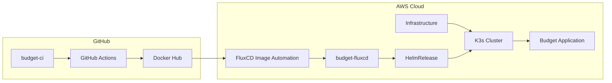
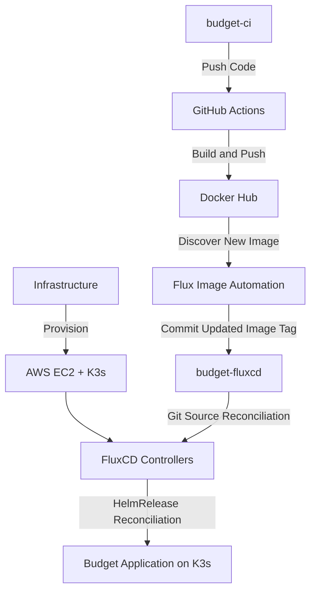

# Budget CI/CD Pipeline

Budget-CI is a fork of the [Laravel Budget application](https://github.com/range-of-motion/budget) that demonstrates a complete **CI/CD workflow using GitHub Actions, Docker Hub, Kubernetes (K3s), and FluxCD**.

The primary goal of this project is to automate Docker image building and publishing, then integrate with a GitOps deployment workflow through the [`budget-fluxcd`](https://github.com/Kru2003/budget-fluxcd) repository.

## Architecture Overview

The following diagram illustrates the complete CI/CD and GitOps workflow:



## Continuous Integration (GitHub Actions)

The GitHub Actions workflow, located at `.github/workflows/ci.yaml`, automates building and publishing Docker images.

### Workflow Trigger

The workflow is triggered whenever code is pushed to the `main` branch. It can also be extended to run on pull requests for validation.

### Workflow Steps

1. **Checkout Code:** Uses `actions/checkout@v4` to fetch the repository contents.
2. **Testing:** Installs PHP/Composer, runs composer install, runs PHP CodeSniffer (lint), applies migrations (SQLite), and runs PHPUnit and Laravel Dusk (browser) tests.
3. **Set Up Docker Buildx:** Configures Docker builds using `docker/setup-buildx-action`.
4. **Docker Hub Authentication:** Uses `docker/login-action@v3` to authenticate with Docker Hub.
5. **Image Tagging:** Generates Docker image tags using the Git branch, short commit SHA, and Unix timestamp.
6. **Build and Push:** Uses `docker/build-push-action@v6` to build the Docker image and publish it to Docker Hub.

### Docker Image Tag Format

This project generates image tags using git branch, short commit SHA, and Unix timestamp to ensure traceability between application code and deployed container images.

**Tagging Convention:**
```
<branch>-<short-sha>-<timestamp>
```

For example:

```bash
krupanshi20/budget:main-abc1234-1793894400
```

### Workflow Output

The primary output of the workflow is a Docker image published to Docker Hub.

**Docker Hub Repository:** [`krupanshi20/budget`](https://hub.docker.com/r/krupanshi20/budget)


## Security and Configuration

Before running the workflow, configure the following secrets in your GitHub repository:

Navigate to:

**Settings → Secrets and variables → Actions → New repository secret**

| Name | GitHub Configuration | Description |
|---|---|---|
| `DOCKER_USERNAME` | Repository Variable | Docker Hub username |
| `DOCKER_ACCESS_TOKEN` | Repository Secret | Docker Hub access token |
| `APP_DATABASE` | Repository Variable | Database name |
| `APP_DATABASE_PASSWORD` | Repository Secret | Database password | 

> **Important:** Never hardcode credentials or commit secrets to the repository. Always use GitHub Actions secrets.


## Troubleshooting

### 1. Docker Build Failures

If the GitHub Actions workflow fails during the Docker build process:

- Check the GitHub Actions workflow logs.
- Verify that the Dockerfile exists in the repository.
- Check for missing system packages or dependencies.
- Verify Composer dependencies and application configuration.
- Ensure all required files are included in the Docker build context.

### 2. Docker Hub Login Errors

If Docker authentication fails:

- Verify that `DOCKER_USERNAME` is correctly configured.
- Ensure that `DOCKER_ACCESS_TOKEN` is valid.
- Check whether the Docker Hub token has the required permissions.
- Generate a new access token if the existing one has expired.

### 3. Docker Image Not Found

After a successful GitHub Actions workflow, verify that the image exists in Docker Hub.

Pull the image using:

```bash
docker pull krupanshi20/budget:<YOUR_TAG>
```

Replace `<YOUR_TAG>` with the actual published tag.

You can verify available tags here:

https://hub.docker.com/r/krupanshi20/budget/tags


## Related Projects

This project is part of a larger DevOps ecosystem consisting of three repositories.

| Repository | Description |
|---|---|
| `budget-ci` | Application source code and GitHub Actions CI pipeline for building and publishing Docker images |
| `budget-fluxcd` | GitOps repository containing Helm configurations and FluxCD resources for application deployment |
| `Infrastructure` | Infrastructure repository containing Terraform configurations for AWS, EC2, K3s, and FluxCD setup |

## Complete DevOps Workflow

The three repositories work together to implement an automated DevOps pipeline:


